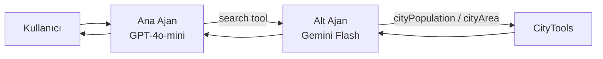

# Spring AI Çoklu Ajan Sistemi

Spring AI ile geliştirilmiş, **iki farklı yapay zekâ modelinin birlikte çalıştığı** bir çoklu ajan (multi-agent) örneği. Ana ajan **GPT-4o-mini**, alt ajan **Gemini Flash** ile çalışır. Ana ajan kullanıcıyla konuşur ve ne yapılacağına karar verir, alt ajan ise tool calling ile veri araştırır.

## Nasıl Çalışıyor?

Alt ajan, ana ajanın elindeki bir tool'un içine yerleştirilmiş ikinci bir LLM çağrısıdır. Ana model Gemini'nin varlığından haberdar değildir, sadece "şehir verisi araştıran bir tool" görür.



Örnek akış: *"Ankara mı İzmir mi daha kalabalık?"*

1. Ana ajan soruyu alır ve şehir verisi gerektiğini anlayıp `search` tool'unu çağırır.
2. Alt ajan (Gemini) `cityPopulation` tool'unu iki şehir için ayrı ayrı çağırır.
3. Veriler ana ajana döner, ana ajan son cevabı yazar.

## Özellikler

- **İki modelli mimari:** Ana ve alt ajan farklı sağlayıcılardan (OpenAI + Google) çalışır
- **Tool calling:** `@Tool` ile tanımlı araçlar (nüfus, yüzölçümü, tarih/saat)
- **Gemini entegrasyonu:** Google'ın OpenAI uyumlu endpoint'i üzerinden, ek bağımlılık gerektirmeden
- **Hata yönetimi:** Veri yoksa `VERI_YOK`, alt ajan hata verirse `HATA:` etiketi döner, ana ajan bunu kullanıcıya düzgünce anlatır
- **Merkezi exception handler:** `@RestControllerAdvice` ile standart `ProblemDetail` hata cevapları

## Kullanılan Teknolojiler

- Java 17+
- Spring Boot, Spring AI 2.0.1
- OpenAI (GPT-4o-mini), Google Gemini (Flash)
- Maven

## Kurulum

### Gereksinimler

- Java 17 veya üzeri
- OpenAI API key
- Google Gemini API key ([Google AI Studio](https://aistudio.google.com/))

### API key'leri tanımlama

Key'ler koda yazılmaz, ortam değişkeni olarak okunur:

```
OPENAI_API_KEY=...
GEMINI_API_KEY=...
```

IntelliJ IDEA'da: **Run → Edit Configurations → Environment variables** alanına ekleyebilirsin.

### Çalıştırma

```bash
./mvnw spring-boot:run
```

Windows'ta:

```
mvnw.cmd spring-boot:run
```

Uygulama `http://localhost:8081` adresinde açılır.

## Ayarlar

`src/main/resources/application.properties`:

```properties
server.port=8081
spring.ai.openai.api-key=${OPENAI_API_KEY}
spring.ai.openai.chat.model=gpt-4o-mini
spring.ai.openai.chat.options.temperature=0.2
gemini.api-key=${GEMINI_API_KEY}
gemini.model=gemini-2.5-flash
```

## Endpoint'ler

| Endpoint | Açıklama |
|---|---|
| `GET /youtube/agent?message=...` | Çoklu ajan akışı: ana ajan alt ajanı çağırır |
| `GET /youtube/city?message=...` | Şehir tool'larını doğrudan ana modelle kullanır |
| `GET /youtube/time?message=...` | Tarih/saat tool'u |
| `GET /youtube/popular?genre=...` | Tool kullanmayan basit sohbet örneği |

### Örnek istekler

```
GET /youtube/agent?message=Ankara mı İzmir mi daha kalabalık?
GET /youtube/agent?message=İzmir'in yüzölçümü kaç?
GET /youtube/agent?message=Bursa'nın nüfusu kaç?
```

Son istekte Bursa verisi olmadığı için ajan sayı uydurmak yerine verinin bulunamadığını söyler.

## Proje Yapısı

```
src/main/java/dev/tunahan/spring_ai/
├── AgentConfig.java            # Gemini'ye bağlı alt ajan client'ı
├── ChatController.java         # REST endpoint'leri
├── ResearchAgentTool.java      # Alt ajanı tool olarak saran sınıf
├── CityTools.java              # Nüfus ve yüzölçümü tool'ları
├── DateTimeTools.java          # Tarih/saat tool'u
├── AgentException.java         # Ajan hataları için özel exception
├── GlobalExceptionHandler.java # Merkezi hata yönetimi
└── SpringAiApplication.java
```

## Hata Yönetimi

| Durum | Davranış |
|---|---|
| Şehir verisi yok | Tool `VERI_YOK` döner, ajan hangi bilginin bulunamadığını söyler |
| Alt ajan çöktü (kota, ağ, key) | `HATA:` döner, ana ajan verinin alınamadığını bildirir |
| Ajan hatası | `503 Service Unavailable` |
| Beklenmeyen hata | `500 Internal Server Error` |
| Spring MVC hataları (yanlış adres, eksik parametre) | Doğru 4xx kodu |

Hata cevaplarında iç detay veya key bilgisi istemciye verilmez, sadece konsola yazılır.

## Yol Haritası

- [ ] İkinci alt ajan (analist: yoğunluk, karşılaştırma hesapları)
- [ ] Sabit veri yerine PostgreSQL
- [ ] Sohbet belleği (ChatMemory)
- [ ] RAG ile doküman tabanlı soru-cevap
- [ ] Gözlem ve izleme (token kullanımı, ajan çağrı logları)

## Notlar

Şehir verileri örnek amaçlı sabit bir `Map` içindedir ve yaklaşık değerlerdir.
